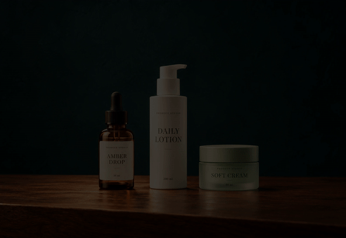

# Product Spotlight Video Skill

**Upload a product photo. Get a short ad where products light up one by one, then all together.**

A reusable AI-agent skill inspired by a static-photo light-switch editing technique. The agent prepares a product scene, masks and typography; the bundled renderer delivers a stable, synchronized MP4 with original switch sounds.

The only required user input is a product photo. A video reference, product names, aspect ratio and soundtrack are optional.



[Watch the demo with sound](assets/demo.mp4). The demo scene and packaging are AI-generated fictional products; no third-party tutorial soundtrack is included.

## What it creates

- A dramatic dark scene with three product reveals and a final all-on moment.
- Yellow-green condensed headings that appear with each illuminated product.
- An approximately 8.53-second H.264/AAC MP4 at 30 fps.
- Matching bright/dark images, individual state previews, audio and a render manifest.
- Original synthesized switch sounds when no audio is provided.

For a single-product photo, the AI scene can show three identical instances. For a group photo, the agent uses the actual products. Other product counts are supported with a custom timeline.

## Install

This is an **agent skill**, not a hosted upload website. Use it with an agent that can read local skills, inspect images, run Python and ideally generate/edit images.

Download the packaged skill ZIP from [Releases](https://github.com/Yukilin-coder/product-spotlight-video-skill/releases/latest), or clone the repository below. Extract the ZIP before copying the skill folder. A `.skill` archive is provided as well for clients that support importing that format.

```bash
git clone https://github.com/Yukilin-coder/product-spotlight-video-skill.git
cd product-spotlight-video-skill
python -m pip install -r product-spotlight-video/requirements.txt
```

Copy the `product-spotlight-video` folder into your agent's skill directory. For Codex, the usual directory is `~/.codex/skills/`; for Claude Code, use `~/.claude/skills/`. Restart or reload your agent if needed to discover the new skill. The skill uses your host's image-generation tool; it does not require or configure an API key itself.

Windows PowerShell example for Codex:

```powershell
Copy-Item -Recurse -LiteralPath .\product-spotlight-video -Destination "$env:USERPROFILE\.codex\skills\product-spotlight-video"
```

## Use it

Upload or attach a product photo and ask:

> Use $product-spotlight-video to turn this photo into a product ad. Light the three products one at a time, pause in darkness between reveals, then light them all together. Use the default switch sounds and export the video.

With one product:

> Use $product-spotlight-video with this skincare bottle. Show three identical copies, preserve the packaging, and use the captions “01 / DAILY”, “02 / DAILY”, and “03 / DAILY”.

With an optional reference:

> Use $product-spotlight-video with my photo and this tutorial recording. Recreate the embedded creative clip's light-switch timing and typography, excluding the tutorial UI and presenter. Extract the audio from that creative segment.

The agent handles scene preparation, object masks and configuration. You do not need to provide JSON or draw masks.

## How it works

1. Inspect the uploaded photo and preserve product identity.
2. Prepare **one** all-on scene, optionally using AI to recompose it.
3. Derive a dark frame from that same scene; never generate independent light states.
4. Define per-product masks and caption positions.
5. Render the reveal timeline and synchronize sound.
6. Inspect state previews and verify the final video decodes completely.

Using a fixed scene keeps products stable during light changes. RGB-plane masks prevent the accidental color spill that can occur with YUV chroma masks.

## Renderer for developers

The renderer does not perform AI generation or automatic object detection. It accepts a prepared all-on image and JSON configuration, which the agent builds from your photo. See [the configuration guide](product-spotlight-video/references/configuration.md).

```bash
python product-spotlight-video/scripts/render.py --config scene.json --output output
```

Use `--ffmpeg /path/to/ffmpeg` to specify a binary. Otherwise the renderer uses system FFmpeg or the binary provided by `imageio-ffmpeg`. Choose an empty output directory, or explicitly pass `--overwrite`.

Try the included example without generating a new image:

```bash
python product-spotlight-video/scripts/render.py --config examples/demo.json --output output
```

```bash
python -m unittest discover -s tests -v
```

Tests generate simple geometric fixtures, validate independent lighting, frame count, audio, custom aspect ratios and event validation. They do not call an image-generation API or validate arbitrary generated product identity.

## Limits and product accuracy

AI-generated viewpoints can alter details, especially packaging text and brand marks. For strict product fidelity, preserve the original photo composition and use masks there. Without a host image tool, this original-layout approach remains available.

Reference matching is approximate when the source is a compressed screen recording or the original font is unavailable. This skill recreates the editing technique; it does not promise a pixel-identical copy. Product captions and ingredients must come from supplied facts, rather than invented claims.

Your uploaded media stays in the working/output directory unless you explicitly authorize an upload. This repository does not include the original tutorial, its soundtrack, or the creator's private photo files. The default audio is generated from scratch.

## License

Skill instructions and source code: [MIT](LICENSE). Image-generation services, FFmpeg distributions, user-provided media and installed fonts retain their own terms/licenses.
